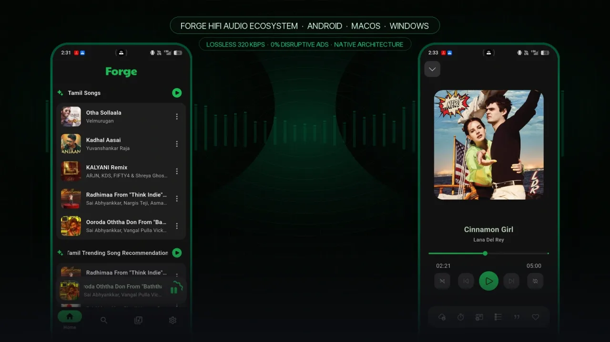
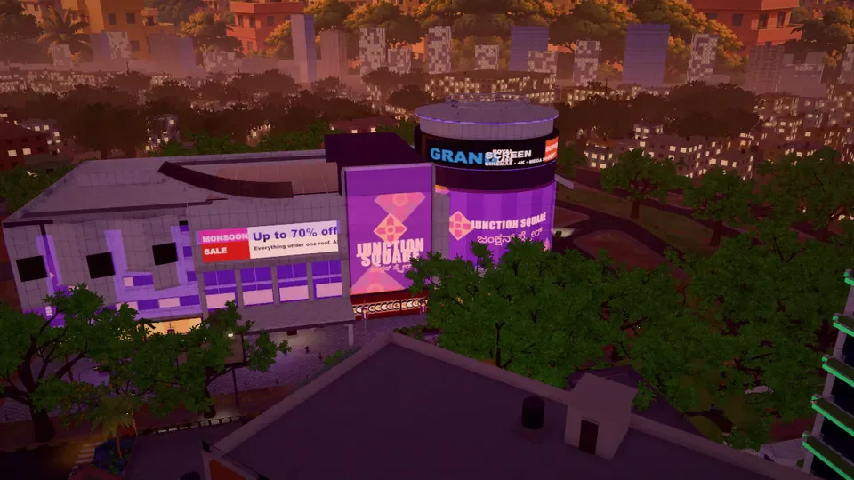
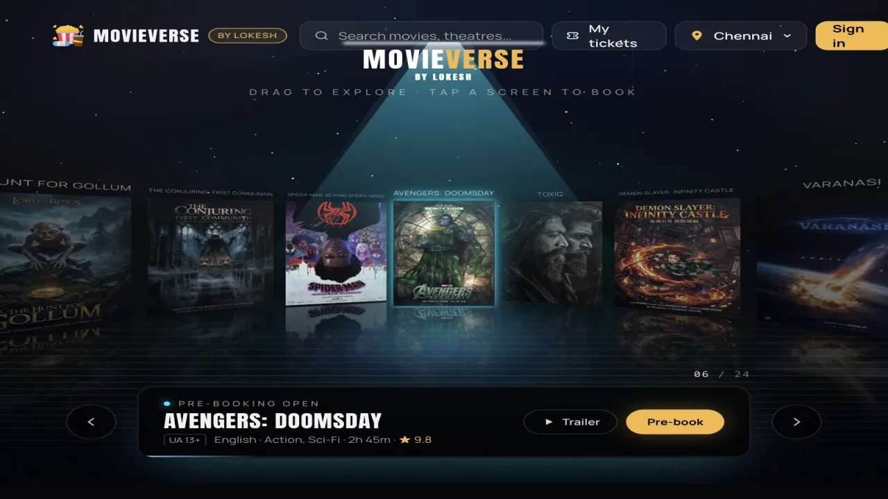

<h1 align="center">Hi 👋, I'm M. Lokesh</h1>
<h3 align="center">Software Developer | Full-Stack & Mobile App Engineer | Creator of Forge</h3>

  

  
  
  
  

  

---

### 👨‍💻 About Me

- 💻 Passionate Software Engineer crafting cross-platform mobile applications, interactive web ecosystems, and modern software architectures.
- 🚀 Creator & Lead Developer of the **[Forge Music](https://github.com/lokesh12dev/Forge)** ecosystem, **Namma Forge**, and **Main Residence**.
- 🎨 Focused on creating seamless, accessible, and intuitive user experiences with cutting-edge UI engineering and 3D web spaces.
- 🛠️ Core tech stack includes **Flutter, Dart, Kotlin, React, Next.js, TypeScript, Tailwind CSS, and Python**.
- 🌐 Explore my latest projects, live demos, and interactive spaces on my **[Portfolio](https://lokesh-online-three.vercel.app/pro)**.

 

---

## 🏆 Featured Projects (Top Tier Showcase)

<table>
  <tr>
    <td width="50%" valign="top">
      
      <h3 align="center">🎵 Forge Music Ecosystem</h3>
      

        
        
      

      
A free, open-source Spotify-inspired cross-platform music streaming and playback application crafted for Android, macOS, Windows, Linux, and Web.

      

        <code>Flutter</code> • <code>Dart</code> • <code>Kotlin</code> • <code>WebAudio</code> • <code>Android SDK</code>
      

    </td>
    <td width="50%" valign="top">
      
      <h3 align="center">🏙️ Namma Forge</h3>
      

        
      

      
An immersive open-world interactive space and software simulation exploring the urban architecture, streets, and vibrant landmarks of Bengaluru.

      

        <code>Next.js</code> • <code>Three.js</code> • <code>WebGL</code> • <code>Canvas</code> • <code>Interactive 3D</code>
      

    </td>
  </tr>
  <tr>
    <td width="50%" valign="top">
      
      <h3 align="center">🏛️ Main Residence</h3>
      

        
      

      
High-fidelity interactive 3D virtual spatial environment and architectural digital space built for smooth real-time web exploration.

      

        <code>Three.js</code> • <code>GLTF / 3D</code> • <code>Tailwind CSS</code> • <code>Framer Motion</code>
      

    </td>
    <td width="50%" valign="top">
      
      <h3 align="center">🎬 MovieVerse Hub</h3>
      

        
      

      
Dynamic cinematic discovery and media exploration platform featuring seamless trailer playback, curated watchlists, recommendations, and rich movie metadata.

      

        <code>Next.js</code> • <code>React</code> • <code>Tailwind CSS</code> • <code>REST APIs</code>
      

    </td>
  </tr>
  <tr>
    <td width="50%" valign="top">
      
      <h3 align="center">⚡ LessBusy Productivity</h3>
      

        
      

      
Minimalist, distraction-free productivity and workflow management app engineered to help developers and creators organize daily high-priority tasks effortlessly.

      

        <code>Next.js</code> • <code>TypeScript</code> • <code>Tailwind CSS</code> • <code>Vercel</code>
      

    </td>
    <td width="50%" valign="top">
      
      <h3 align="center">🌐 Interactive Developer Portfolio</h3>
      

        
      

      
Official developer portfolio featuring interactive spaces, immersive UI components, selected works, and comprehensive software journey.

      

        <code>Next.js</code> • <code>Three.js / Canvas</code> • <code>Framer Motion</code> • <code>Tailwind CSS</code>
      

    </td>
  </tr>
</table>

---

<h3 align="left">🤝 Connect with me:</h3>

  
  
  

---

<h3 align="left">Languages and Tools: </h3>

  
  
  
  
  
  
  
  
  
  
  
  
  
  
  
  
  
  
  
  
  
  
  
  
  
  
  
  
  
  
  
  
  
  
  
  
  
  
  
  
  
  
  
  
  
  
  
  
  
  
  
  
  
  
  
  
  
  
  
  
  
  
  
  
  
  
  
  
  

